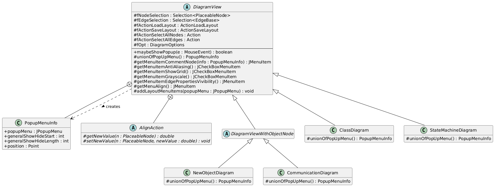

> **Pre-refactor documentation** — describes the popup menu code as it was *before* the PopupMenuBuilder refactor.

# Popup Menu – DiagramView Feature Documentation

## Overview

`DiagramView` is an abstract base class for all diagram panels in USE. It provides the core popup menu infrastructure through `unionOfPopUpMenu()`, which builds a `JPopupMenu` wrapped in a `PopupMenuInfo` object.

The menu is triggered by `maybeShowPopup(MouseEvent e)`, which checks `e.isPopupTrigger()` and, if true, calls `unionOfPopUpMenu()` and shows the menu.

Subclasses override `unionOfPopUpMenu()` to extend or replace the base menu:

| Subclass                | Calls `super`? | Strategy           |
|-------------------------|----------------|--------------------|
| `ClassDiagram`          | Yes            | Extends base menu  |
| `NewObjectDiagram`      | Yes            | Extends base menu  |
| `CommunicationDiagram`  | No             | Builds own menu    |
| `StateMachineDiagram`   | No             | Builds own menu    |

---

## UML Class Diagram (Popup Feature)



```plantuml
@startuml DiagramView_PopupMenu

skinparam classAttributeIconSize 0
hide empty members

abstract class DiagramView {
  # fNodeSelection : Selection<PlaceableNode>
  # fEdgeSelection : Selection<EdgeBase>
  # fActionLoadLayout : ActionLoadLayout
  # fActionSaveLayout : ActionSaveLayout
  # fActionSelectAllNodes : Action
  # fActionSelectAllEdges : Action
  # fOpt : DiagramOptions
  --
  + maybeShowPopup(e : MouseEvent) : boolean
  # unionOfPopUpMenu() : PopupMenuInfo
  # getMenuItemCommentNode(info : PopupMenuInfo) : JMenuItem
  # getMenuItemAntiAliasing() : JCheckBoxMenuItem
  # getMenuItemShowGrid() : JCheckBoxMenuItem
  # getMenuItemGrayscale() : JCheckBoxMenuItem
  # getMenuItemEdgePropertiesVivibility() : JMenuItem
  # getMenuAlign() : JMenuItem
  # addLayoutMenuItems(popupMenu : JPopupMenu) : void
}

class "DiagramView.PopupMenuInfo" {
  + popupMenu : JPopupMenu
  + generalShowHideStart : int
  + generalShowHideLength : int
  + position : Point
}

abstract class "DiagramView.AlignAction" {
  # {abstract} getNewValue(n : PlaceableNode) : double
  # {abstract} setNewValue(n : PlaceableNode, newValue : double) : void
}

abstract class DiagramViewWithObjectNode {
}

class ClassDiagram {
  # unionOfPopUpMenu() : PopupMenuInfo
}

class NewObjectDiagram {
  # unionOfPopUpMenu() : PopupMenuInfo
}

class CommunicationDiagram {
  # unionOfPopUpMenu() : PopupMenuInfo
}

class StateMachineDiagram {
  # unionOfPopUpMenu() : PopupMenuInfo
}

DiagramView +-- "DiagramView.PopupMenuInfo"
DiagramView +-- "DiagramView.AlignAction"

DiagramView <|-- DiagramViewWithObjectNode
DiagramView <|-- ClassDiagram
DiagramView <|-- StateMachineDiagram

DiagramViewWithObjectNode <|-- NewObjectDiagram
DiagramViewWithObjectNode <|-- CommunicationDiagram

DiagramView ..> "DiagramView.PopupMenuInfo" : creates >

@enduml
```

---

## Base Popup Menu Items (`DiagramView.unionOfPopUpMenu()`)

The following items are built by the base implementation in the order they appear in the menu.

---

### 1. Add comment node
- **Type:** `JMenuItem`
- **Always shown:** Yes
- **Functionality:** Creates a new `CommentNode` at the position where the user right-clicked and adds it to the diagram graph. The node appears immediately after the action.

---

### 2. Hide selected properties *(conditional)*
- **Type:** `JMenuItem`
- **Shown when:** The node selection is non-empty **and** every selected node is an `EdgeProperty`.
- **Functionality:** Sets `visible = false` on every selected `EdgeProperty` (e.g., a role name or multiplicity label), hiding it from the diagram without removing it from the model.

---

### 3. Show or hide edge properties *(conditional submenu)*
- **Type:** `JMenu`
- **Shown when:** One or more edges are selected (`fEdgeSelection` is non-empty).
- **Functionality:** Contains controls to manage visibility of edge properties (role names, multiplicities, association names) on the selected edges.
  - **Show all properties** – Makes every `EdgeProperty` of all selected edges visible.
  - **Hide all properties** – Hides every `EdgeProperty` of all selected edges.
  - *(Separator — only when exactly one edge is selected)*
  - **Per-property group submenus** *(single-edge selection only)* – One `JMenu` per property group:
    - **Source end properties** – `JCheckBoxMenuItem` per property on the source side.
    - **Target end properties** – `JCheckBoxMenuItem` per property on the target side.
    - **Edge properties** – `JCheckBoxMenuItem` per property on the edge itself.
    - Each checkbox directly toggles `EdgeProperty.setVisible()`.

---

### *(Separator)*

---

### 4. Show attributes
- **Type:** `JCheckBoxMenuItem`
- **State reflects:** `DiagramOptions.isShowAttributes()`
- **Functionality:** Toggles the display of the attributes compartment on all class/object nodes in the diagram. Triggers `invalidateContent(true)` to recalculate node sizes.

---

### 5. Show association names
- **Type:** `JCheckBoxMenuItem`
- **State reflects:** `DiagramOptions.isShowAssocNames()`
- **Functionality:** Toggles the display of association name labels drawn in the centre of association edges. Triggers `invalidateContent(true)`.

---

### 6. Show role names
- **Type:** `JCheckBoxMenuItem`
- **State reflects:** `DiagramOptions.isShowRolenames()`
- **Functionality:** Toggles the display of role name labels at association ends. Triggers `invalidateContent(true)`.

---

### *(Separator)*

---

### 7. Align elements *(submenu)*
- **Type:** `JMenu`
- **Enabled when:** Two or more nodes are selected.
- **Functionality:** Aligns the selected nodes along a shared axis. The **first** selected node defines the reference value; all others are moved to match it.
  - **Left** – Aligns left edges (X position) of all selected nodes.
  - **Center** – Aligns horizontal centers of all selected nodes.
  - **Right** – Aligns right edges (X + width) of all selected nodes.
  - *(Separator)*
  - **Top** – Aligns top edges (Y position) of all selected nodes.
  - **Middle** – Aligns vertical centers of all selected nodes.
  - **Bottom** – Aligns bottom edges (Y + height) of all selected nodes.

---

### 8. Anti-aliasing
- **Type:** `JCheckBoxMenuItem`
- **State reflects:** `DiagramOptions.isDoAntiAliasing()`
- **Functionality:** Enables or disables anti-aliased rendering on the diagram canvas. Triggers `repaint()`.

---

### 9. Show grid
- **Type:** `JCheckBoxMenuItem`
- **State reflects:** `DiagramOptions.showGrid()`
- **Functionality:** Shows or hides a light-gray dotted grid overlay on the diagram canvas as a visual alignment guide. Triggers `repaint()`.

---

### 10. Grayscale view
- **Type:** `JCheckBoxMenuItem`
- **State reflects:** `DiagramOptions.grayscale()`
- **Functionality:** Switches the diagram between full-color and grayscale rendering. Also updates the selection highlight color of all waypoints on visible and hidden edges. Triggers `repaint()`.

---

### *(Items added by `addLayoutMenuItems()`:)*

### *(Separator)*

---

### 11. Auto-Layout
- **Type:** `JCheckBoxMenuItem`
- **State reflects:** `DiagramOptions.isDoAutoLayout()`
- **Functionality:** Starts or stops the spring-based auto-layout background thread (`LayoutThread`). When active, nodes are continuously repositioned by a force-directed algorithm.

---

### 12. Layouts *(submenu)*
- **Type:** `JMenu`
- **Functionality:** One-shot structured layout algorithms. Each item opens a **Layouts Settings** dialog (`LayoutsOptionDialog`) where the user can configure horizontal spacing, vertical spacing, and whether to place association class nodes on their relations before the layout is applied.
  - **Hierarchical layout** – Top-to-bottom tree layout.
  - **Hierarchical Upside Down layout** – Bottom-to-top tree layout.
  - *(Separator)*
  - **Horizontal layout** – Left-to-right tree layout.
  - **Horizontal Right to Left layout** – Right-to-left tree layout.
  - *(Separator)*
  - **Swimlane (Based on Filmstrip) Landscape layout** – Landscape-oriented swimlane layout derived from the filmstrip structure.
  - **Swimlane (Based on Filmstrip) Portrait layout** – Portrait-oriented swimlane layout derived from the filmstrip structure.

---

### 13. Reset layout
- **Type:** `JMenuItem` (Action)
- **Functionality:** Calls `DiagramView.resetLayout()`. Resets all node positions back to a random/default arrangement, discarding any manual or auto layout that was applied.

---

### 14. Load layout
- **Type:** `JMenuItem` (bound to `fActionLoadLayout`)
- **Functionality:** Opens a file chooser dialog to select a saved layout file (`.olt`). Restores node positions and diagram options from the file via `loadLayout(Path)`.

---

### 15. Save layout
- **Type:** `JMenuItem` (bound to `fActionSaveLayout`)
- **Enabled when:** The diagram graph is non-empty.
- **Functionality:** Opens a file chooser dialog to save the current node positions and diagram options to a layout file (`.olt`) via `saveLayout(Path)`.

---

### *(Separator + items below — conditional: only shown if the graph has at least one node)*

---

### 16. Select all nodes *(conditional)*
- **Type:** `JMenuItem` (Action)
- **Shown when:** The diagram has at least one visible node.
- **Functionality:** Adds all currently visible nodes to `fNodeSelection`, then calls `repaint()` to show the selection highlighting.

---

### 17. Select all edges *(conditional)*
- **Type:** `JMenuItem` (Action)
- **Shown when:** The diagram has at least one visible node (same condition as above).
- **Functionality:** Adds all currently visible edges to `fEdgeSelection`, then calls `repaint()`.

---

### 18. Edit text… *(conditional)*
- **Type:** `JMenuItem`
- **Shown when:** Exactly **one** node is selected **and** it is a `Rolename` instance.
- **Functionality:** Opens a scrollable text-area dialog pre-filled with the current role name text. On confirmation, calls `Rolename.setText(newText)` and repaints the diagram.

---

## Extra in the Chat

| #  | Name                     | Type                  | Condition                              |
|----|--------------------------|-----------------------|----------------------------------------|
| 1  | Add comment<br>node      | JMenuItem             | Always                                 |
| 2  | Hide selected<br>properties | JMenuItem         | Only if selection is all EdgeProperty  |
| 3  | Show or hide<br>edge properties | JMenu        | Only if edges are selected             |
| 4  | Show<br>attributes       | JCheckBoxMenuItem     | Always                                 |
| 5  | Show<br>association names | JCheckBoxMenuItem    | Always                                 |
| 6  | Show role<br>names       | JCheckBoxMenuItem     | Always                                 |
| 7  | Align elements           | JMenu (6 sub-items)   | Enabled only if 2+ nodes selected      |
| 8  | Anti-aliasing            | JCheckBoxMenuItem     | Always                                 |
| 9  | Show grid                | JCheckBoxMenuItem     | Always                                 |
| 10 | Grayscale view           | JCheckBoxMenuItem     | Always                                 |
| 11 | Auto-Layout              | JCheckBoxMenuItem     | Always                                 |
| 12 | Layouts                  | JMenu (6 sub-items)   | Always                                 |
| 13 | Reset layout             | JMenuItem             | Always                                 |
| 14 | Load layout              | JMenuItem             | Always                                 |
| 15 | Save layout              | JMenuItem             | Enabled only if graph non-empty        |
| 16 | Select all<br>nodes      | JMenuItem             | Only if graph has nodes                |
| 17 | Select all<br>edges      | JMenuItem             | Only if graph has nodes                |
| 18 | Edit text…               | JMenuItem             | Only if exactly one Rolename is selected |