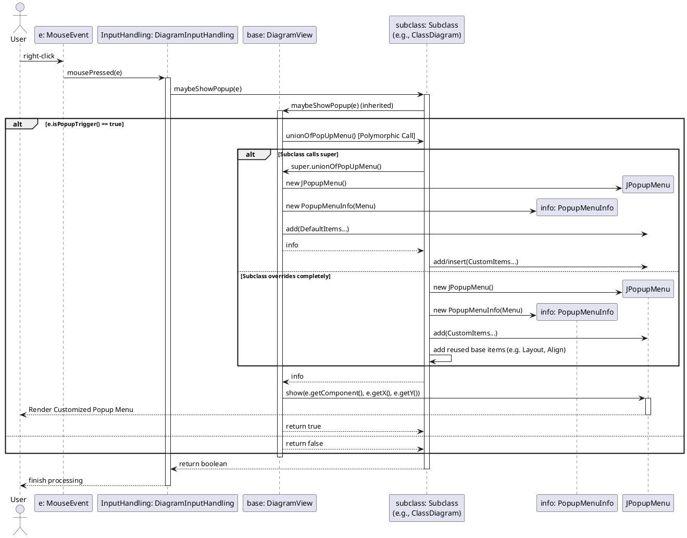

> **Pre-refactor documentation** — describes the popup menu code as it was *before* the PopupMenuBuilder refactor.

# DiagramView PopupMenu Control Flow Analysis

## Sequence Diagram (Popup Flow with Overrides)

## ClassDiagram
- **Overview**: Represents the static structure of the model (classes, associations).
- **Key Differences from DiagramView**:
  - Adds items specific to displaying/hiding classes, operations, multiplicities, and constraints.
  - Reuses base menu items by calling `super.unionOfPopUpMenu()` and interleaves its own configuration options using the `generalShowHideStart` index.
- **Popup Menu Items**:
- 
  | Item Name | Action | Source (Base / Custom) |
  |-----------|--------|------------------------|
  | Default base items | Features like Comment Node, Align, Anti-aliasing | Base |
  | Show operations | Toggles operation visibility | Custom |
  | Multiplicities | Toggles multiplicity display | Custom |
  | Sub/Superclasses | Selects or hides related inheritance elements | Custom |
  | Hide/Crop | Hides specific selected classes/associations | Custom |

## NewObjectDiagram
- **Overview**: Displays runtime object instances, their states, and links.
- **Key Differences from DiagramView**:
  - Prepends items at index `0` for manipulating objects, destroying them, or viewing life paths, pushing generic display options down.
  - Relies on `super.unionOfPopUpMenu()` for the standard foundation.
- **Popup Menu Items**:
- 
  | Item Name | Action | Source (Base / Custom) |
  |-----------|--------|------------------------|
  | Default base items | General view toggles, grid, and layout | Base |
  | Edit Properties | Opens property editor for selected object | Custom |
  | Destroy Object | Removes object from current state | Custom |
  | Insert/Delete Links | Modifies links between objects | Custom |
  | Show hidden elements| Restores visibility of hidden runtime elements | Custom |

## CommunicationDiagram
- **Overview**: Shows interactions between objects as messages on links.
- **Key Differences from DiagramView**:
  - Fully constructs its own `JPopupMenu` without calling `super.unionOfPopUpMenu()`.
  - Manually pulls in specific base features (Layout, Align, Comment Node) but discards generic view checkboxes (like attribute visibility).
- **Popup Menu Items**:
- 
  | Item Name | Action | Source (Base / Custom) |
  |-----------|--------|------------------------|
  | Partial base items | Comment Node, Align, Layout options | Base (Manual reuse) |
  | Show neighborhood | Selects adjacent communicating objects | Custom |
  | Show Life States | Toggles display of object life state | Custom |
  | Messages Navigation | Options to step through communication messages | Custom |
  | Synchronize seq diag| Syncs view with sequence diagram | Custom |

## StateMachineDiagram
- **Overview**: Visualizes the states and transitions of an object's life cycle.
- **Key Differences from DiagramView**:
  - Fully constructs its own menu without hitting `super` to avoid irrelevant structural options.
  - Focuses strictly on state properties and transition manipulation.
- **Popup Menu Items**:
- 
  | Item Name | Action | Source (Base / Custom) |
  |-----------|--------|------------------------|
  | Partial base items | Comment Node, Align, Layout options | Base (Manual reuse) |
  | Show State Invariant| Toggles visibility of state invariants | Custom |
  | Merge/Demerge | Options for grouping/ungrouping transitions | Custom |

