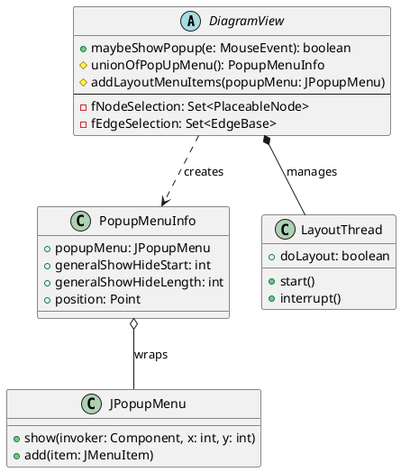
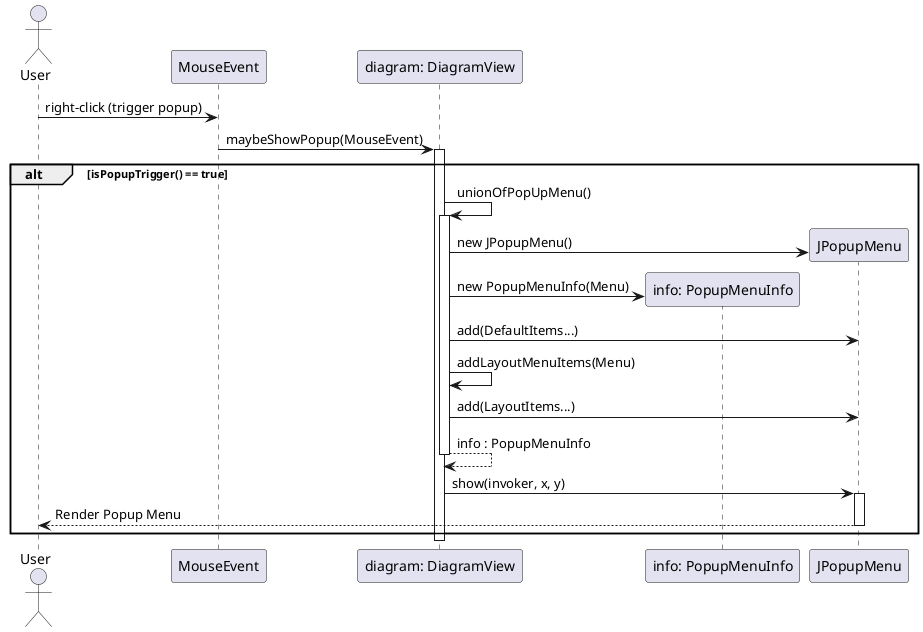

> **Pre-refactor documentation** — describes the popup menu code as it was *before* the PopupMenuBuilder refactor.

# DiagramView Popup Menu Documentation

## 1. Class Structure (UML Class Diagram)

## 2. Control Flow (Sequence Diagram)

## 3. Popup Menu Items

Below is the list of default popup menu items added by `DiagramView#unionOfPopUpMenu()` and `DiagramView#addLayoutMenuItems()`.

| Menu Item | Triggered Action / Behavior | Can Subclasses Override? |
| :--- | :--- | :--- |
| **Comment Node** | Adds a comment node (`getMenuItemCommentNode`). | Yes (via `getMenuItemCommentNode` override) |
| **Hide selected properties** | Hides selected `EdgeProperty` nodes. | No (anonymous action) |
| **Visibility...** (Edge Properties) | Sets edge properties visibility. | Yes (via `getMenuItemEdgePropertiesVivibility` override) |
| **Show attributes** | Toggles `fOpt.isShowAttributes()` and repaints. | No |
| **Show association names** | Toggles `fOpt.isShowAssocNames()` and repaints. | No |
| **Show role names** | Toggles `fOpt.isShowRolenames()` and repaints. | No |
| **Align** (Submenu) | Alignment options for selected nodes (`getMenuAlign()`). | Yes (via `getMenuAlign` override) |
| **Anti-Aliasing** | Toggles anti-aliasing (`getMenuItemAntiAliasing()`). | Yes |
| **Show grid** | Toggles grid display (`getMenuItemShowGrid()`). | Yes |
| **Grayscale** | Toggles grayscale mode (`getMenuItemGrayscale()`). | Yes |
| **Edit text...** | Opens a dialog to edit the text of a selected `Rolename` node. | No |
| **Auto-Layout** | Starts/Stops `LayoutThread`. | No |
| **Layouts** (Submenu) | Opens `LayoutsOptionDialog` with options (Hierarchical, Horizontal, Swimlane, etc.). | No |
| **Reset layout** | Calls `resetLayout()`. | No |
| **Load layout** | Calls `fActionLoadLayout`. | No |
| **Save layout** | Calls `fActionSaveLayout`. | No |
| **Select all nodes/edges** | Selects all elements in `fGraph`. | No |

*Note on Overriding:* `unionOfPopUpMenu()` itself is `protected`, so subclasses (such as `ClassDiagram`, `ObjectDiagram`) can and do override `unionOfPopUpMenu()`, typically calling `super.unionOfPopUpMenu()` and inserting or removing items from `JPopupMenu` using its API. Methods returning specific menu items (like `getMenuAlign()`) can be overridden individually.

