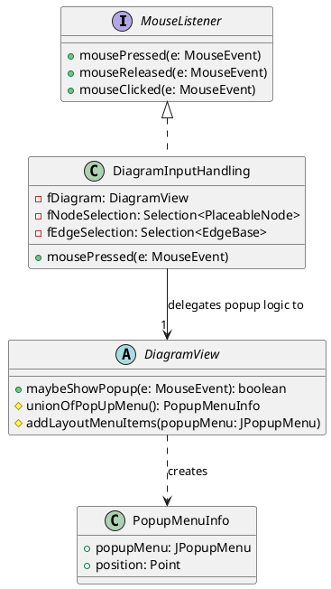
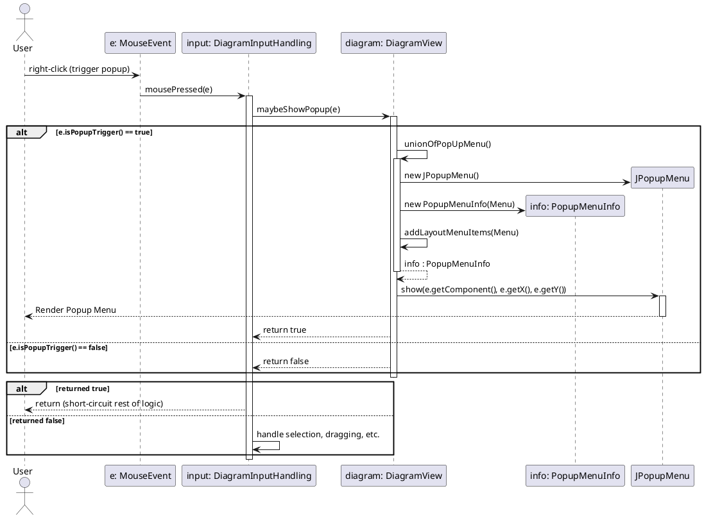

> **Pre-refactor documentation** — describes the popup menu code as it was *before* the PopupMenuBuilder refactor.

# DiagramView Popup Menu Control Flow Analysis

## Updated UML Class Diagram

## Updated Sequence Diagram

## Control Flow Explanation

1. **User Interaction**: The user right-clicks (or performs an OS-specific popup trigger action) on the diagram. This generates a `MouseEvent`.
2. **Input Handling Intercept (DiagramInputHandling)**: The `MouseEvent` is received by `DiagramInputHandling.mousePressed(MouseEvent e)`. The `DiagramInputHandling` class acts as the central controller for all mouse interactions on the diagram surface.
3. **Popup Delegation**: As the very first action in `mousePressed`, `DiagramInputHandling` delegates checking for a popup menu to the UI layer by calling `fDiagram.maybeShowPopup(e)`.
4. **Popup Menu Verification (DiagramView)**: Inside `DiagramView.maybeShowPopup`, the event is checked using the Java generic `e.isPopupTrigger()` method.
    - If `false`, `maybeShowPopup` returns `false`, and `DiagramInputHandling` continues to process the mouse event as a normal click (handling node selection, dragging, double-clicks for resizing, etc.).
5. **Popup Menu Construction**: If `e.isPopupTrigger()` is `true`:
    - `DiagramView` calls `#unionOfPopUpMenu()`, which constructs the base `JPopupMenu`.
    - It wraps it in a `PopupMenuInfo` object.
    - It appends layout-related menu items using `#addLayoutMenuItems(popupMenu)`.
    - It configures the menu with context-aware items based on what elements are currently selected (stored in the diagram's selection state).
6. **Popup Rendering**: `DiagramView` then positions and displays the `JPopupMenu` by invoking `popupMenu.show(...)` directly on the screen.
7. **Execution Short-Circuit**: Back in `DiagramInputHandling`, receiving `true` from `maybeShowPopup` causes `mousePressed` to immediately `return`. This effectively drops the mouse event and explicitly prevents the popup click from triggering node selections, drag operations, or other background logic, beautifully separating the UI popup rendering from the diagram's canvas interaction logic.

